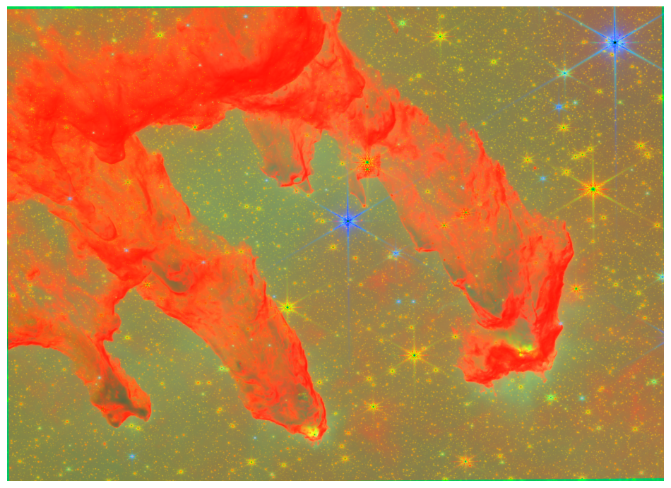

What i did on my summer vacation

*The final rendered image output by Python*

As someone passionate about space, images of things coming out of space telescopes always fascinated me. this project is attempting to replicate the rendering of such an image, leading to somewhat orangeish greenish results. the technical definition of what we were doing is "rendering a partial image of the eagle nebula" with a side goal of learning about python

(Note, the renders we were using were a part of stsci prop 2739, which asked the james webb telescope to take photos of cool looking stuff for publicity)

The plan to do it involved a not insignificant amount of googling, but in summary it boiled down to "find 3 images of the pillars in red, green, and blue, then  render them all together" python and google colab were chosen by manner of convenience, and astropy was chosen for being the first library we could find that would let us accomplish it

## Glossary of Terms

- Jupyter Notebook: a way to present code and data in a shareable format (uses python language as suggested by the "py")
- Google Colab: Coding environment that allows for collaboration by being stored in the cloud developed by google
- Astropy: python library allowing for operations involving various space related stuff (such as downloading things from MAST)
- MAST [mikulski archive for space telescopes]: Huge archive of space telescope images
- FITS [flexible image transport system]: file format specialized for astronomical image data

## Conclusion

Final thoughts, this was a fun project. it definitely challenged me in a way i was not used to, and i got better because of it. I look forward to doing something like this again in the future
## Sources

- [STSCI Proposal 2739](https://www.stsci.edu/jwst-program-info/download/jwst/pdf/2739/) - authors, year, etc 
- [JWST Science Data Overview](https://jwst-docs.stsci.edu/accessing-jwst-data/jwst-science-data-overview#gsc.tab=0) 

